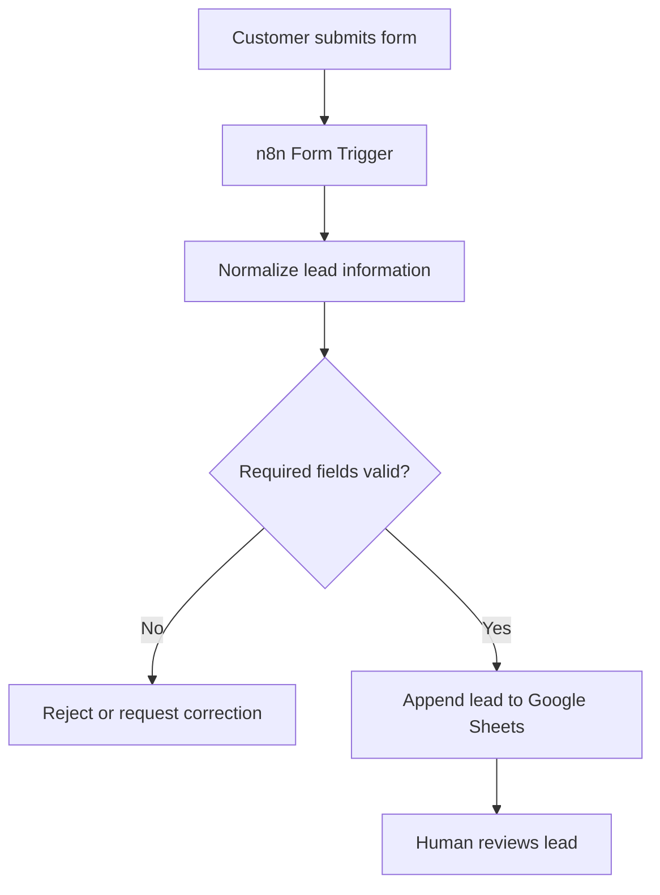

# AI Lead Capture & Qualification with n8n

> Capture website inquiries, validate submissions, organize leads, and prepare them for human follow-up.

**Status:** Implementation guide — not yet tested in a live n8n instance.

## 1. Overview

This workflow helps small businesses collect customer inquiries through an online form and store them in Google Sheets.

**Tools required:**
- n8n
- Google Sheets
- An n8n Form Trigger node

**Best for:**
- Freelancers
- Agencies
- SaaS businesses
- Consultants
- Service providers
- Small businesses

## 2. What the Workflow Does

1. A visitor submits an inquiry form.
2. n8n receives the submitted information.
3. Required information is checked.
4. Valid submissions are normalized.
5. Lead information is added to Google Sheets.
6. The business owner can review and follow up.

## 3. Workflow Architecture

## 4. Prepare Google Sheets

Create a spreadsheet named:

`Business Leads`

Add these columns:

| Column | Purpose |
|---|---|
| created_at | Submission time |
| full_name | Customer name |
| email | Customer email |
| company | Business name |
| inquiry_type | Type of request |
| message | Customer message |
| source | Where the lead came from |
| status | New, contacted, qualified, or closed |

## 5. Build the Workflow in n8n

### Node 1 — Form Trigger

Add the **n8n Form Trigger** node.

Create these form fields:

- Full name — required
- Email — required
- Company — optional
- Inquiry type — required
- Message — required

Use clear field labels and helpful descriptions.

### Node 2 — Edit Fields

Add an **Edit Fields** node.

Prepare consistent fields for the next node:

- `created_at`
- `full_name`
- `email`
- `company`
- `inquiry_type`
- `message`
- `source`
- `status`

Map incoming values using the n8n expression editor.

Normalize email addresses by trimming whitespace and converting them to lowercase.

Set the initial status to `new`.

### Node 3 — Validate the Submission

Add an **IF** node.

Check that:

- Full name is present.
- Email is present and has a valid email format.
- Inquiry type is present.
- Message is not empty.

Do not assume that a non-empty email field proves the address belongs to the customer.

Route invalid submissions to an appropriate correction or error response.

### Node 4 — Google Sheets

Add the Google Sheets node.

Connect your Google account through n8n credentials.

Select:

- Resource: Sheet
- Operation: Append Row
- Document: Business Leads
- Sheet: The worksheet containing your columns

Map each prepared field to its matching spreadsheet column.

Do not use example credentials or expose API keys.

### Node 5 — Review the Lead

After saving the submission, make the lead available for human review.

The owner should decide:
- Whether the inquiry is relevant.
- Whether more information is required.
- Whether to contact the potential customer.
- Whether the lead is qualified.

Do not automatically reject customers based solely on an AI-generated score.

## 6. Optional AI Enhancement

Once the basic workflow works, add an AI classification step.

Possible classification fields:

- Inquiry category
- Customer's stated problem
- Urgency
- Suggested follow-up questions
- Reason for classification
- Confidence level

Treat classifications as suggestions, not verified facts.

Preserve the original customer message and allow a human to correct the AI result.

The core workflow should continue to preserve the lead even when optional AI classification fails.

## 7. Test the Workflow

Use sample submissions before connecting a real website.

Test these cases:

| Test | Expected result |
|---|---|
| Complete valid submission | Lead saved |
| Missing required field | Submission rejected or corrected |
| Invalid email format | Validation fails |
| Long message | Data remains intact |
| Repeated submission | Duplicate handling needs review |
| Google Sheets connection failure | Execution reports an error |

Inspect the execution data and confirm that each field reaches the correct spreadsheet column.

## 8. Important Limitations

This baseline does not automatically prevent duplicate submissions.

A production version should consider:

- Duplicate detection using normalized email or a unique submission ID.
- Spam protection and submission rate limits.
- Appropriate data retention.
- Restricted spreadsheet access.
- Failure alerts and recovery.
- Human review for important customer decisions.

Never collect sensitive personal information unless it is necessary and appropriately protected.

## 9. Success Criteria

The workflow is ready for a small pilot when:

- Valid submissions reach the spreadsheet.
- Invalid submissions are handled correctly.
- Field mappings are correct.
- Failed executions can be identified.
- Credentials are stored securely in n8n.
- The business owner can review leads.

## 10. Further Improvements

Potential future additions:

- Gmail notifications.
- CRM integration.
- AI-assisted lead categorization.
- Duplicate detection.
- Follow-up reminders.
- Lead performance reporting.

---

**Kinetix AI Vault**

Practical AI Resources. Powerful Skills. Better Workflows.
